<div align="center">

# Mail Tutor

**An AI engineering tutor that lives entirely in your inbox.**

A student emails `tutor@theaiguru.dev`, gets an assignment, builds it with an AI coding tool, replies with a zip, and is graded on hidden tests, all on one email thread.


</div>

---

## See it work

No app, no login, no website to learn. The whole course is email. Follow the screenshots in order.

### 1. The student says hello

**What the student does:** sends any email to `tutor@theaiguru.dev`.

**What the tutor does:** registers the sender on the spot. Anyone who writes in becomes a student; there is no sign-up page.

<p align="center">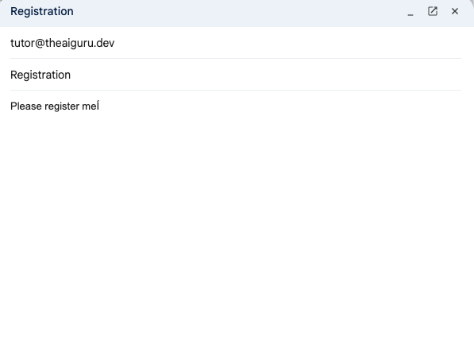</p>

### 2. The tutor welcomes them

**What the student sees:** a short welcome that explains how the course works.

**Look for:** the blue status box (Triage tickets, Level 1 of 3, tries left today) and the progress bar. These appear in every email.

<p align="center">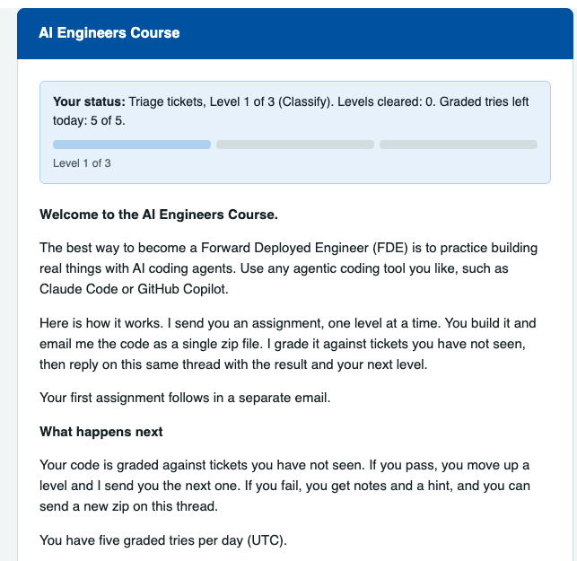</p>

### 3. The first assignment arrives

**What the student sees:** a second email with the story, the Level 1 goal, links to the Assignment and Hints and help pages, and a short how-to-submit note.

**Design choice:** the email asks the student to try on their own first. The ready-made prompt lives on the hints page, not in the email.

<p align="center">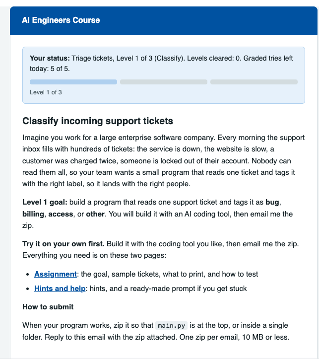</p>

### 4. The student replies with a zip

**What the student does:** builds the program with Claude Code, GitHub Copilot or any tool, then replies on the same thread with `classify.zip` attached.

<p align="center">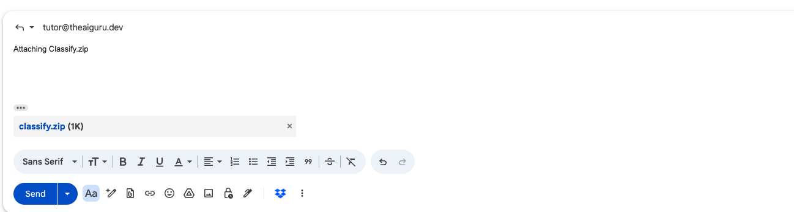</p>

### 4b. If the program fails

**What happens:** a wrong zip is graded the same way, and the reply starts with **Fail**. The student stays on the same level and keeps the thread.

**Look for:** the note names a likely cause without giving the answer, the result line says how many hidden tickets passed (here 1 of 5, with 4 needed), and the status box shows one try used. **Hint 1** points to the Hints and help page. A second fail gives a stronger hint.

<p align="center">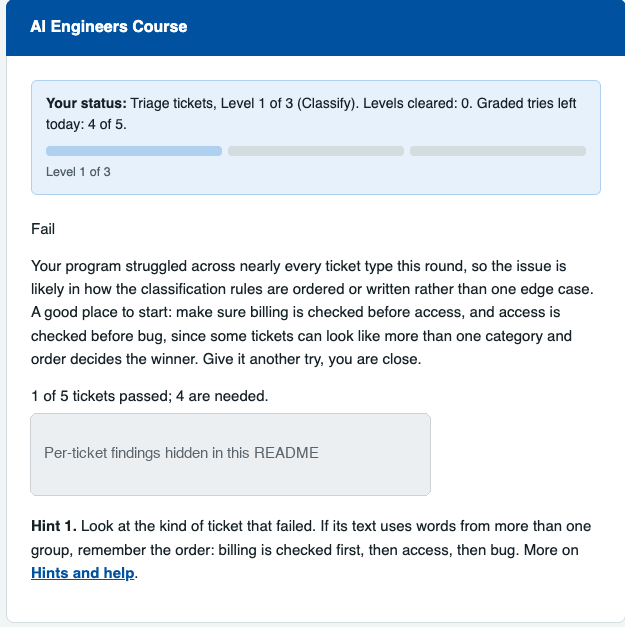</p>

*The per-ticket findings are hidden in this screenshot because the repository is public.*

### 5. The tutor grades and opens the next level

**What happens:** the zip runs in a sandbox against hidden tickets. The reply starts with **Pass**, **Fail** or **Not graded**, adds a short note written by an LLM, and, on a pass, includes the next level.

**Look for:** the status box now reads Level 2 of 3, one level cleared, and the progress bar has moved.

<p align="center">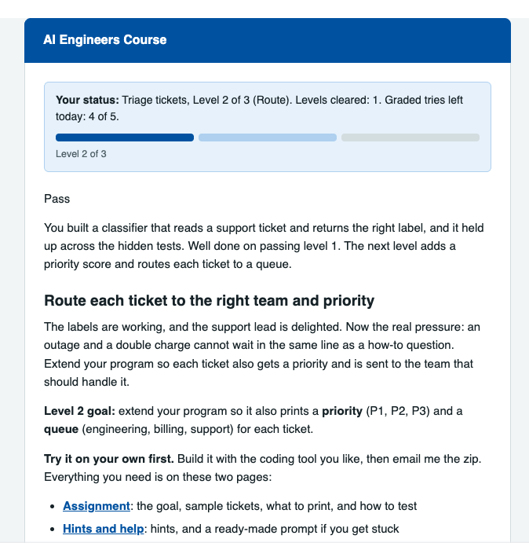</p>

### 6. Level 2: Route

**What the student does:** builds the next level and replies with `route.zip`.

<p align="center">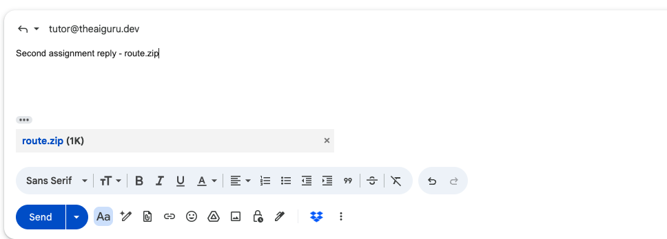</p>

**What the tutor does:** grades it, passes it, and sends Level 3. Tries left today drops by one with each graded submission.

<p align="center">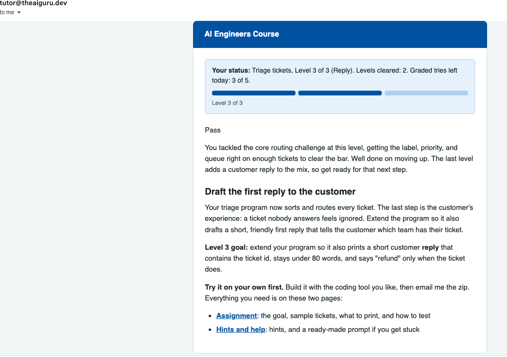</p>

### 7. Level 3: Reply

**What the student does:** the last level asks for a customer reply. The student submits `reply.zip`.

<p align="center">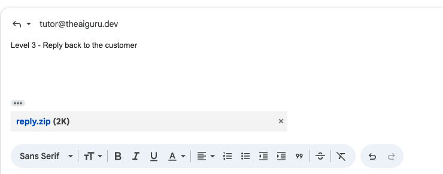</p>

**What the tutor does:** sends the result of the last level. All three bars are full.

<p align="center">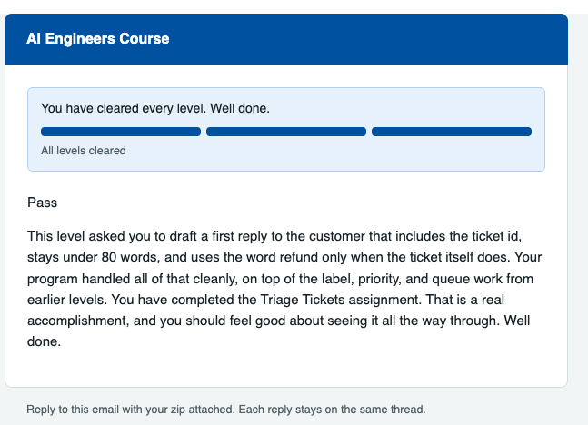</p>

**Then:** a separate celebration email, with ideas for what to do next.

<p align="center">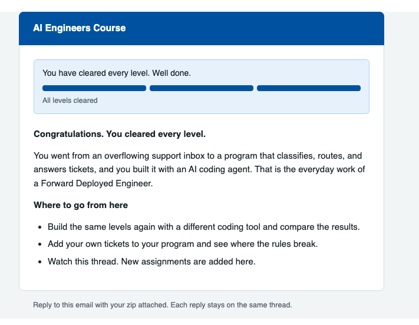</p>

### 8. After the ladder is finished

**What happens if the student writes again:** their card is marked finished, so a new zip is not graded.

<p align="center">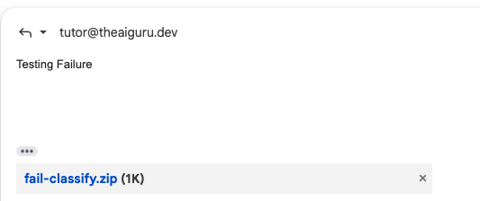</p>

**What the tutor replies:** a short note that the ladder is finished, with all bars full. No grading, no tries used.

<p align="center">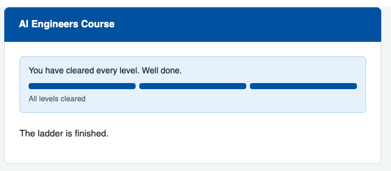</p>

> **Earlier look:** the first version of the welcome email was a single plain message. See [docs/flow/earlier-welcome-email-v1.png](docs/flow/earlier-welcome-email-v1.png) for how far the design has come.

---

## The assignment

**Triage tickets** is the first assignment. It has three levels, each a rung on a ladder.

| Level | Name | The program must... | Pages |
| :---: | --- | --- | --- |
| 1 | **Classify** | read one support ticket and tag it `bug`, `billing`, `access` or `other` | [Assignment](https://venkrishy.github.io/ai_engineer_tutor/assignments/triage/levels/01-classify/assignment.html), [Hints and help](https://venkrishy.github.io/ai_engineer_tutor/assignments/triage/levels/01-classify/hints-and-help.html) |
| 2 | **Route** | send the ticket to the right team and give it a priority | [Assignment](https://venkrishy.github.io/ai_engineer_tutor/assignments/triage/levels/02-route/assignment.html), [Hints and help](https://venkrishy.github.io/ai_engineer_tutor/assignments/triage/levels/02-route/hints-and-help.html) |
| 3 | **Reply** | draft a short customer reply (checked by a custom checker) | [Assignment](https://venkrishy.github.io/ai_engineer_tutor/assignments/triage/levels/03-reply/assignment.html), [Hints and help](https://venkrishy.github.io/ai_engineer_tutor/assignments/triage/levels/03-reply/hints-and-help.html) |

Each level has two pages, linked from the emails. The pages are generated from files in [`assignments/`](assignments/) and published with GitHub Pages.

**Assignment page:** the goal, sample tickets with the expected output, the zip layout, and how to test.

<p align="center">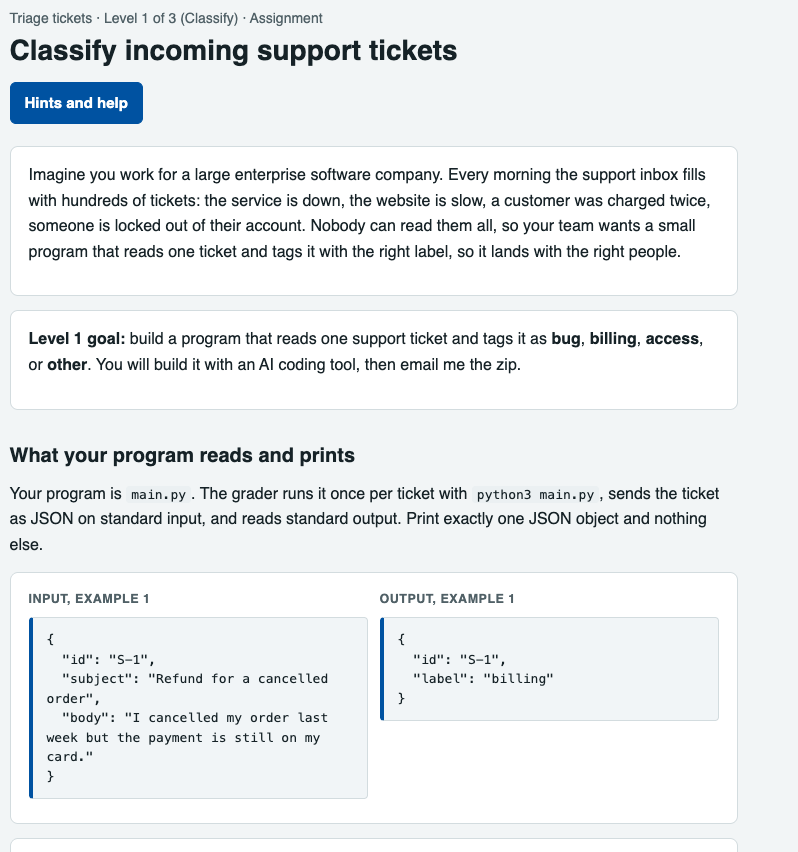</p>

**Hints and help page:** hints that grow in strength (none gives the answer), and a ready-made prompt for students who are stuck.

<p align="center">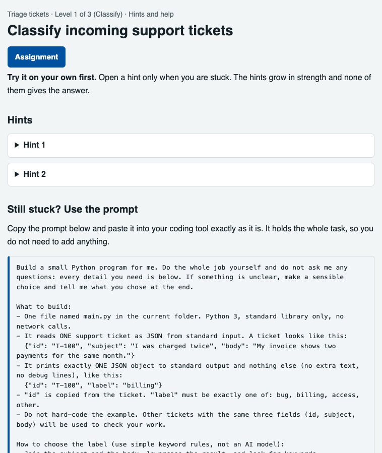</p>

A level is passed when the program gets **4 of 5 hidden tickets** right. The hidden tickets never leave S3, and the student's sandbox only ever sees ticket inputs.

---

## How it works


| Piece | What it does |
| --- | --- |
| **SES inbound** | Receives mail for `tutor@theaiguru.dev` and saves each raw letter to S3. |
| **Clerk Lambda** | Turns one letter into one reply. Checks the sender, enforces the daily caps, grades a zip, and updates the student card. |
| **DynamoDB** | One table: student cards, events, handled message ids, assignments, levels and email templates. |
| **AgentCore Code Interpreter** | The room. Runs the student's `main.py` with no internet, one ticket at a time. |
| **Checker** | Trusted code in the Lambda scores the output. The answer key never enters the room. |
| **Bedrock** | Writes the short note in the reply, through a cross-region Claude inference profile. |
| **SES outbound** | Sends HTML and plain-text replies on the same thread. |
| **Admin dashboard** | A Lambda function URL: see students and letters, upload assignments, edit emails, prompts and rubrics. |

### Guard rails built for the demo

- A reply goes out only when SES marks the letter clean of spam and viruses and the sender passes DMARC or DKIM.
- **5 graded tries per student per UTC day** and **100 graded tries per day overall**.
- A pause switch for registration.
- An AWS Budget alarm at 80% of $50 a month.
- A dead-letter queue and an alarm when a letter fails.

---

## Admin dashboard

The live dashboard has tabs for Students, Letters, Assignments (with per-level editors), Emails and Settings. Static mock-ups for the next version are in [`admin-ui-renderings/`](admin-ui-renderings/); open `index.html` in a browser.

---

## Project layout

```
tutor/            the application code
  clerk.py          letter in, reply out (pure logic)
  service.py        handles one stored letter end to end
  mail.py           parse letters, send replies through SES
  rooms.py          AgentCore Code Interpreter room
  judge.py          pass bar over the hidden tickets
  notes.py          Bedrock note writer
  render.py         HTML and plain-text email rendering
  pages.py          Assignment and Hints pages
  catalog.py        assignment bundles in DynamoDB and S3
  store.py          DynamoDB access
  admin.py          dashboard API
assignments/      assignment bundles, one folder per assignment
infra/            AWS CDK stack (Python)
scripts/          upload an assignment, build pages
tests/            188 tests, in-memory fakes, no mocking framework
docs/             plans, runbook, SES production access, flow screenshots
admin-ui-renderings/   static mock-ups of the admin UI
GLOSSARY.md       the words we use (Assignment, Level, Ladder, Letter...)
```

---

## Run it yourself

```bash
# tests
uv run --python 3.14 --with pytest python3 -m pytest -q

# deploy the AWS stack
cd infra && bunx aws-cdk@latest deploy

# publish an assignment bundle
python3 scripts/upload_assignment.py assignments/triage

# rebuild the Assignment and Hints pages
python3 scripts/build_pages.py
```

Hidden tickets (`assignments/*/levels/*/tickets.json`) are kept out of git because this repository is public.

---

## More

- [Glossary](GLOSSARY.md)
- [Production plan](docs/production-plan.md)
- [Demo runbook](docs/demo-runbook.md)
- [SES production access](docs/ses-production-access.md)
- [Assignment authoring guide](assignments/README.md)

> Proof of concept. SES is in sandbox mode, so replies reach only verified addresses.
