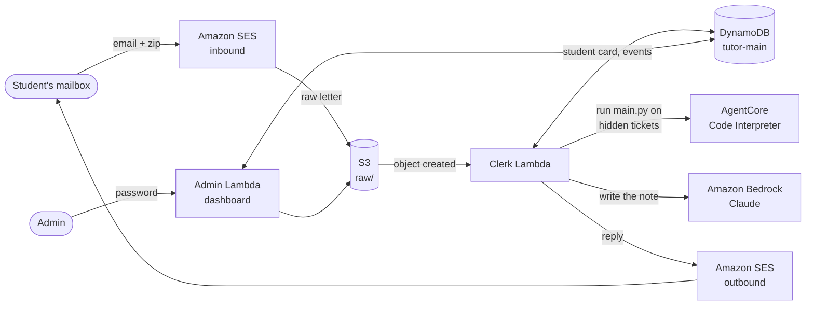

<div align="center">

# Mail Tutor

**An AI engineering tutor that lives entirely in your inbox.**

A student emails `tutor@theaiguru.dev`, gets an assignment, builds it with an AI coding tool, replies with a zip, and is graded on hidden tests, all on one email thread.


</div>

---

## See it work

No app, no login, no website to learn. The whole course is email.

### 1. The student says hello

Anyone who writes in is registered on the spot. The first email can say anything.

<p align="center"></p>

### 2. The tutor welcomes them

A short welcome explains how the course works, shows a status box with a progress bar, and says how many graded tries are left today.

<p align="center"></p>

### 3. The first assignment arrives

A second email holds the assignment: a story, the goal for Level 1, links to the assignment page and the hints page, and how to submit.

<p align="center"></p>

### 4. The student replies with a zip

The student builds the program with Claude Code, GitHub Copilot or any tool they like, then replies on the same thread with `classify.zip` attached.

<p align="center"></p>

### 5. The tutor grades and opens the next level

The zip runs in a sandbox against tickets the student has never seen. The reply starts with **Pass**, **Fail** or **Not graded**, adds a short note written by an LLM, and, on a pass, opens the next level in the same email. The status box moves up and the progress bar fills.

<p align="center"></p>

### 6. Level 2: Route

The student builds the next level and replies with `route.zip`.

<p align="center"></p>

Another pass moves them to Level 3. Graded tries left today drops with each submission.

<p align="center"></p>

### 7. Level 3: Reply

The last level asks for a customer reply, and the student submits `reply.zip`.

<p align="center"></p>

A pass on the last level sends the result first.

<p align="center"></p>

Then a separate celebration email arrives, with ideas for what to do next.

<p align="center"></p>

> **Earlier look:** the first version of the welcome email was a single plain message. See [docs/flow/earlier-welcome-email-v1.png](docs/flow/earlier-welcome-email-v1.png) for how far the design has come.

---

## The assignment

**Triage tickets** is the first assignment. It has three levels, each a rung on a ladder.

| Level | Name | The program must... |
| :---: | --- | --- |
| 1 | **Classify** | read one support ticket and tag it `bug`, `billing`, `access` or `other` |
| 2 | **Route** | send the ticket to the right team |
| 3 | **Reply** | draft a reply to the customer (checked by a custom checker) |

Each level has its own **Assignment** page (goal, sample tickets, expected output, zip layout, how to test) and **Hints and help** page (tiered hints, plus a ready-made prompt for students who are stuck). The pages are generated from files in [`assignments/`](assignments/) and published with GitHub Pages.

A level is passed when the program gets **4 of 5 hidden tickets** right. The hidden tickets never leave S3, and the student's sandbox only ever sees ticket inputs.

---

## How it works



| Piece | What it does |
| --- | --- |
| **SES inbound** | Receives mail for `tutor@theaiguru.dev` and saves each raw letter to S3. |
| **Clerk Lambda** | Turns one letter into one reply. Checks the sender, enforces the daily caps, grades a zip, and updates the student card. |
| **DynamoDB** | One table: student cards, events, handled message ids, assignments, levels and email templates. |
| **AgentCore Code Interpreter** | The room. Runs the student's `main.py` with no internet, one ticket at a time. |
| **Checker** | Trusted code in the Lambda scores the output. The answer key never enters the room. |
| **Bedrock** | Writes the short note in the reply, through a cross-region Claude inference profile. |
| **SES outbound** | Sends HTML and plain-text replies on the same thread. |
| **Admin dashboard** | A Lambda function URL: see students and letters, upload assignments, edit emails, prompts and rubrics. |

### Guard rails built for the demo

- A reply goes out only when SES marks the letter clean of spam and viruses and the sender passes DMARC or DKIM.
- **5 graded tries per student per UTC day** and **100 graded tries per day overall**.
- A pause switch for registration.
- An AWS Budget alarm at 80% of $50 a month.
- A dead-letter queue and an alarm when a letter fails.

---

## Admin dashboard

The live dashboard has tabs for Students, Letters, Assignments (with per-level editors), Emails and Settings. Static mock-ups for the next version are in [`admin-ui-renderings/`](admin-ui-renderings/); open `index.html` in a browser.

---

## Project layout

```
tutor/            the application code
  clerk.py          letter in, reply out (pure logic)
  service.py        handles one stored letter end to end
  mail.py           parse letters, send replies through SES
  rooms.py          AgentCore Code Interpreter room
  judge.py          pass bar over the hidden tickets
  notes.py          Bedrock note writer
  render.py         HTML and plain-text email rendering
  pages.py          Assignment and Hints pages
  catalog.py        assignment bundles in DynamoDB and S3
  store.py          DynamoDB access
  admin.py          dashboard API
assignments/      assignment bundles, one folder per assignment
infra/            AWS CDK stack (Python)
scripts/          upload an assignment, build pages
tests/            188 tests, in-memory fakes, no mocking framework
docs/             plans, runbook, SES production access, flow screenshots
admin-ui-renderings/   static mock-ups of the admin UI
GLOSSARY.md       the words we use (Assignment, Level, Ladder, Letter...)
```

---

## Run it yourself

```bash
# tests
uv run --python 3.14 --with pytest python3 -m pytest -q

# deploy the AWS stack
cd infra && bunx aws-cdk@latest deploy

# publish an assignment bundle
python3 scripts/upload_assignment.py assignments/triage

# rebuild the Assignment and Hints pages
python3 scripts/build_pages.py
```

Hidden tickets (`assignments/*/levels/*/tickets.json`) are kept out of git because this repository is public.

---

## More

- [Glossary](GLOSSARY.md)
- [Production plan](docs/production-plan.md)
- [Demo runbook](docs/demo-runbook.md)
- [SES production access](docs/ses-production-access.md)
- [Assignment authoring guide](assignments/README.md)

> Proof of concept. SES is in sandbox mode, so replies reach only verified addresses.
